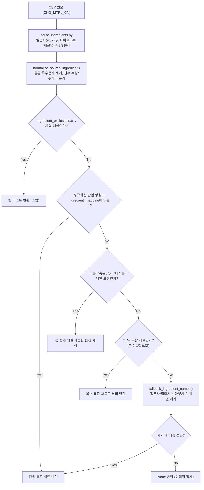

# 🍳 냉장고 기반 레시피 추천 서비스 (MajorProject) - AI 에이전트 인수인계 가이드

> 이 문서는 다른 AI 코딩 에이전트(Claude Code, Cursor, ChatGPT, Codex 등)가 현재 프로젝트의 아키텍처, 진행 상황, 코드 구조 및 작업 규칙을 즉시 이해하고 협업할 수 있도록 작성된 **컨텍스트 프롬프트 문서**입니다.

---

## 1. 프로젝트 개요 (Project Overview)

사용자가 냉장고에 보유한 식재료를 기반으로 적합한 요리 레시피를 추천하고, 레시피 세부 정보 및 재료 매칭율을 제공하는 풀스택 애플리케이션입니다.

* **프론트엔드 (`app/`)**: Android (Kotlin, Jetpack Compose)
* **백엔드 (`backend/`)**: Python 3.11+, FastAPI, SQLAlchemy (ORM), PostgreSQL, Alembic (마이그레이션)
* **목 서버 (`mock-server/`)**: Node.js 기반 프론트엔드 개발용 Mock API
* **현재 Git 브랜치**: `feature/backend-integration`

---

## 2. 현재 작업 맥락 (Current Working Context)

현재 **대용량 만개의레시피 데이터(26,093건, `TB_RECIPE_SEARCH_251231.csv`)를 백엔드 DB에 시딩(Seeding)하고 정규화하는 데이터 파이프라인 고도화 작업**을 진행 중입니다.

### 핵심 문제와 해결 방식
1. **재료명의 비정형성**: 레시피 데이터 원문에는 `"양파 반"`, `"손질 꽃게"`, `"식용유 내지는 버터"`, `"소금/후추"`, `"시판용 곰탕"` 등 수식어, 복합 재료, 대안 표현이 섞여 있어 단일 명칭으로 DB에 직접 넣을 수 없음.
2. **표준 재료 매핑 (`IngredientMapper`)**:
   * 원문 텍스트를 파싱하여 **704개의 표준 재료(Canonical Ingredient, 15개 카테고리)**로 표준화 매핑.
   * `ingredient_mapping.csv`에 표준명 및 포함 별명(`included_names`)을 등록하여 관리.
   * 너무 포괄적이거나 식재료가 아닌 완성 요리(`술`, `소스`, `조미료`, `당근라페` 등)는 `ingredient_exclusions.csv`로 필터링.

---

## 3. 핵심 디렉터리 및 파일 구조

```text
MajorProject/
├── app/                                # 안드로이드 클라이언트 앱
├── backend/                            # FastAPI 백엔드
│   ├── alembic/                        # DB 스키마 마이그레이션 버전
│   ├── app/
│   │   ├── core/                       # 설정, 이모지 매핑(category_emojis.py)
│   │   ├── db/                         # DB 세션 및 연결 설정
│   │   ├── models/                     # SQLAlchemy 모델
│   │   │   ├── recipe.py               # Recipe 모델
│   │   │   ├── ingredient.py           # Ingredient (표준 재료 마스터)
│   │   │   └── recipe_ingredient.py    # RecipeIngredient (레시피-재료 N:M 연결 링크)
│   │   ├── routers/                    # FastAPI 엔드포인트 라우터
│   │   └── services/                   # 비즈니스 로직 (recipe, recommendation 등)
│   ├── data/
│   │   ├── TB_RECIPE_SEARCH_251231.csv # 원본 레시피 데이터셋 (CP949, 26,093행)
│   │   ├── ingredient_mapping.csv      # 표준 재료 매핑 마스터 (UTF-8-BOM, 704개)
│   │   ├── ingredient_exclusions.csv   # 제외 재료/완성요리 목록 (UTF-8-BOM, 29개)
│   │   └── unresolved_ingredients.csv  # 파싱 실패한 미해결 재료 분석 리포트
│   ├── scripts/
│   │   ├── import_recipes.py           # CSV 파싱 -> 재료 매핑 -> DB 적재 메인 CLI
│   │   ├── ingredient_mapping.py       # IngredientMapper 정규화/매핑 핵심 엔진
│   │   └── parse_ingredients.py       # 원문 필드(CKG_MTRL_CN) 벨문자(\x07)/파이프(|) 분리
│   └── tests/
│       ├── test_import_recipes.py      # 임포트 CLI 옵션 및 배치 테스트
│       ├── test_ingredient_mapping.py  # 수식어, 대안, 슬래시, 정규화 단위 테스트
│       └── test_full_api.py            # API 엔드투엔드 테스트
└── AGENT_PROMPT.md                     # [본 문서] 에이전트 인수인계 가이드
```

---

## 4. 데이터 파이프라인 처리 규칙 및 아키텍처



### 4-1. 미해결 재료(Unresolved)의 DB 적재 정책 (중요)
* **`Ingredient` 테이블 (재료 마스터 DB)**: **추가되지 않음 (스킵)**. 검증된 표준 재료만 등록.
* **`RecipeIngredient` 테이블 (검색용 N:M 링크)**: **추가되지 않음 (스킵)**. 미해결 재료는 추천/검색 필터링에 참여하지 않음.
* **`Recipe.ingredient_all` 컬럼 (상세 화면용 텍스트)**: **원문 텍스트 그대로 보존**. 사용자가 앱에서 레시피를 볼 때는 누락 없이 온전한 재료 목록 표시.
* **`unresolved_ingredients.csv`**: 미해결 재료명과 발생 빈도를 기록하여 추후 매핑 사전 보강에 사용.

### 4-2. 파서에 구현된 주요 정규화 규칙
1. **대안 표현 (`ALTERNATIVE_RE`)**:
   * `"물엿 또는 올리고당"`, `"참기름 or 들기름"`, `"식용유 내지는 버터"` → 첫 번째 유효 재료를 우선 매핑.
2. **슬래시 복합 재료 (`COMPOUND_DELIMITER_RE`)**:
   * `"소금/후추"` → `소금`, `후추` 2개로 분리.
   * `1/2개` 같은 분수 표현 보호 (한글이 포함된 파트만 분리 대상으로 인정).
3. **가공 및 조리 수식어 접두사 분리 (`FALLBACK_PREFIX_RE`)**:
   * `손질`, `손질한`, `송송 썬`, `송송`, `빻은`, `다듬은`, `시판`, `시판용`, `밑간용[-:]?`, `볶음용`, `조림용` 등 자동 분리.
   * `슬라이스`: 일반 재료(`슬라이스 아몬드` → `아몬드`)는 분리하되, **`슬라이스 햄` → `햄`**, **`슬라이스 치즈` → `슬라이스치즈`**는 사전 매핑 우선으로 독립 유지.
4. **부위 및 계량 접미사 분리 (`FALLBACK_SUFFIX_RE`, `FALLBACK_TRAILING_NOISE_RE`)**:
   * `겉잎`, `속대`, `잎`, `줄기`, `뿌리`, `껍질`, `초록부분` 등 분리 (`배추 겉잎` → `배추`).
   * `반` 수량 분리 (`설탕 반`, `물 반`, `양파 반` → 재료명과 수량 `반`으로 각각 분리 보존).
   * 한국어 단위: `통`, `마리`, `인분`, `줄`, `단`, `송이`, `포기`, `묶음`, `리터`, `톨`, `움큼` 지원.

---

## 5. 표준 카테고리 체계 (15개 분류)

모든 표준 재료는 반드시 아래 15개 표준 카테고리 중 하나에 속해야 합니다:
1. `채소류`
2. `육류`
3. `해산물류`
4. `달걀/유제품`
5. `콩/견과류`
6. `곡류/면/가루`
7. `과일류`
8. `버섯류`
9. `조미료/양념`
10. `유지류`
11. `향신료/허브`
12. `물/육수`
13. `가공식품류`
14. `김치/절임류`
15. `음료/주류`

---

## 6. 개발 및 실행 명령어 가이드

모든 백엔드 명령어는 `backend/` 디렉터리에서 실행합니다.

### 6-1. Conda 가상환경 활성화
```bash
conda activate fastapi
```

### 6-2. 단위 테스트 실행
```bash
# 전체 단위 테스트 실행 (현재 58개 테스트 통과 중)
python -m unittest discover tests

# 재료 매핑 전용 테스트 실행
python -m unittest tests.test_ingredient_mapping -v
```

### 6-3. 레시피 임포트 CLI 실행
```bash
# DB 반영 없이 파싱/매핑 결과 및 미해결 리포트 생성 (가장 빈번하게 사용)
python scripts/import_recipes.py --dry-run

# 테스트용 10개 레시피만 드라이런
python scripts/import_recipes.py --dry-run --test 10

# 실제 DB 시딩 (DB 컨테이너 실행 중일 때)
python scripts/import_recipes.py

# 강제 재시딩 (기존 레시피 덮어쓰기)
python scripts/import_recipes.py --force
```

---

## 7. 인코딩 및 코드 작성 주의사항 (중요)

1. **파일 인코딩 제약**:
   * `backend/data/ingredient_mapping.csv` 및 `ingredient_exclusions.csv`는 반드시 **UTF-8 with BOM (`utf-8-sig`)**으로 읽고 써야 한글 깨짐이 발생하지 않습니다.
   * 레시피 원본 CSV(`TB_RECIPE_SEARCH_251231.csv`)는 **CP949** 인코딩입니다.
2. **Windows PowerShell 주의사항**:
   * 터미널에서 `python -c`로 직접 긴 스크립트를 실행할 때 한글 인코딩(`cp949`) 에러가 발생할 수 있으므로, 복잡한 파이썬 작업은 스크립트 파일(`.py`)을 작성하여 실행하는 것이 안전합니다.
3. **매핑 사전 무결성**:
   * `ingredient_mapping.csv` 내에 **동일한 재료명(별명 포함)이 서로 다른 표준 재료에 중복 할당되면 `IngredientMapper.from_csv()`에서 즉시 AssertionError/Conflict가 발생**합니다. 추가 전 반드시 충돌 여부를 검증해야 합니다.
4. **대화 언어**:
   * 사용자는 **한국어 응답**을 원칙으로 요청하므로, 모든 결과 보고와 질문은 한국어로 진행해야 합니다.
